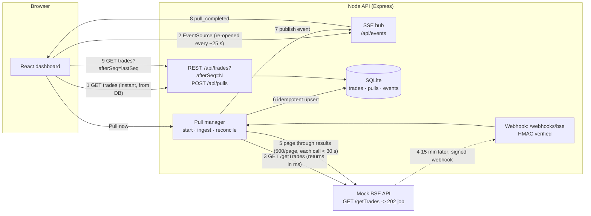
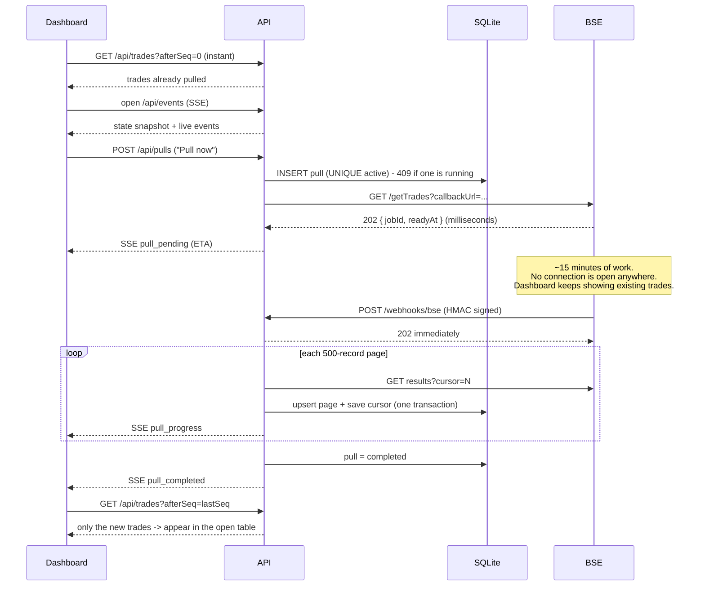

# Architecture note

## The problem

A full BSE pull takes **up to 15 minutes**. The network kills **any HTTP connection open longer than 30 seconds**. So no component may ever wait on a request for the length of a pull — not the dashboard, not our backend, not the BSE client.

The design therefore **separates starting a pull, waiting for it, and showing its results**, and connects those three with durable state and push notifications instead of long-lived connections.

## Diagram

### One pull, end to end

## Why this design

**1. Async job + webhook instead of a long request.**
The BSE call that "takes 15 minutes" becomes three short calls: *create job* (returns `202` in milliseconds), *a signed webhook when it's ready*, and *paged result downloads* (each well under 30 s). The 15-minute wait is spent with zero open connections, so the network limit never comes into play. The webhook is what removes the need for a polling loop or scheduler on our side.

**2. The database is the source of truth, and the UI only reads from it.**
Ingested trades are committed to SQLite as they arrive. That's why the dashboard opens instantly with whatever has been pulled — a `GET /api/trades` is a local indexed read and never depends on the state of a BSE pull. A pull in progress is just a row in `pulls`.

**3. Push, not poll — and the push channel respects the 30 s cap too.**
Server-Sent Events give a one-way stream from API to browser. But a stream is also a connection, and the network would kill it at 30 s. So the server ends each stream cleanly after ~25 s (after sending a `bye` event), and the browser's built-in `EventSource` reconnects in ~0.5 s with `Last-Event-ID`. The server (a) replays events the client missed from a durable `events` table and (b) opens every stream with a **state snapshot**, so even a client that was offline for an hour converges. Heartbeats alone would not be enough against an absolute-duration cap; cycling the stream is what makes it robust. Reconnecting is connection hygiene, not data polling: no data requests are made on a timer. In a real browser run, a full two-pull session produced exactly three `/api/trades` requests — initial load and one per completed pull.

**4. Trades sync by cursor.**
Every trade gets a monotonic `seq`. Clients ask for "everything after seq N", so the first load and every later update use the same code path, and a pull that adds 250 rows to 3 000 transfers 250 rows.

